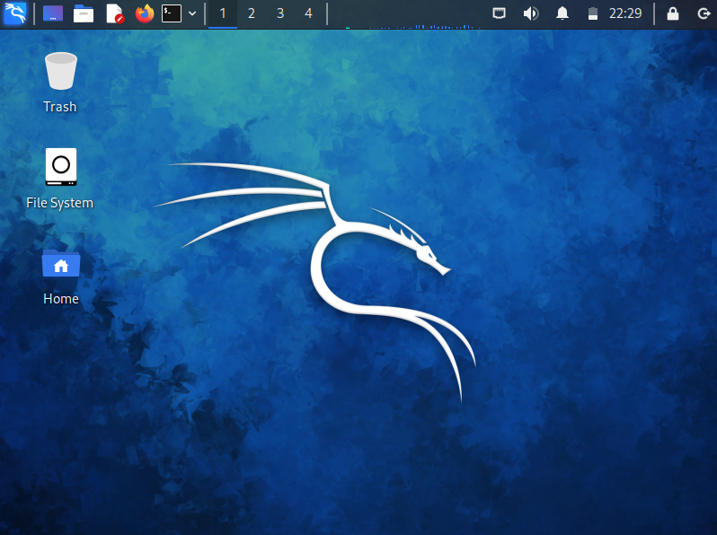
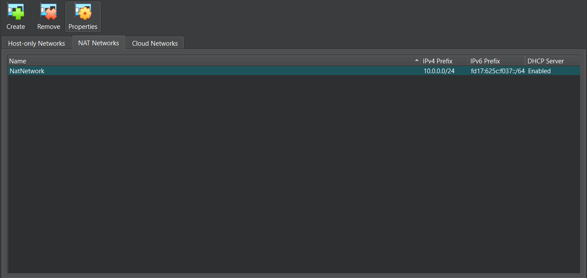
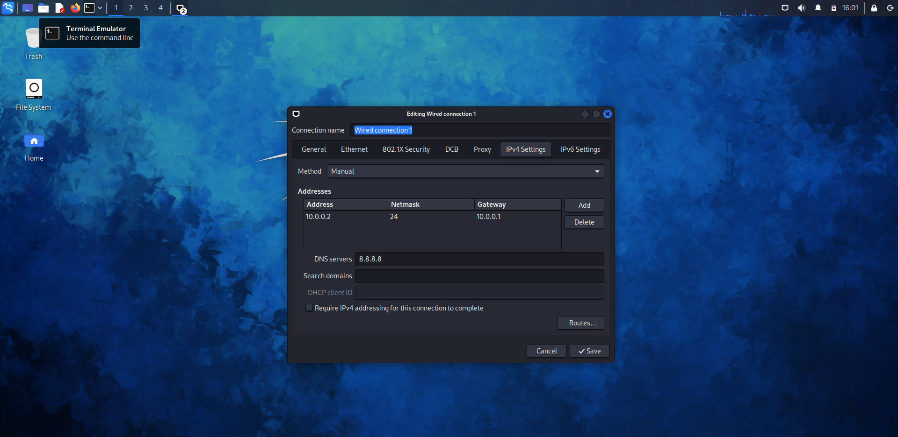
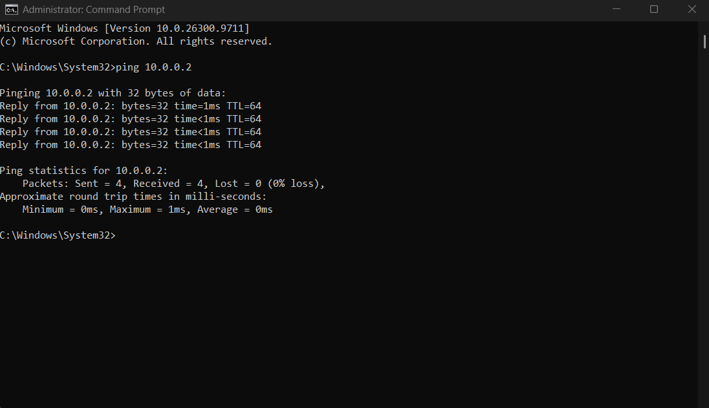
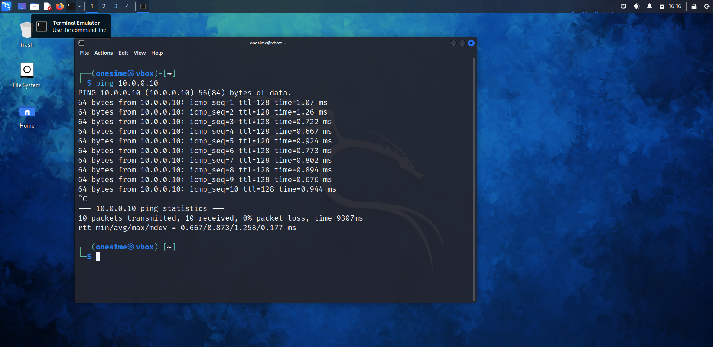

# 📅 Week 1: Virtual Environment Deployment

The primary objective for the first week was to establish a secure, interconnected virtual lab using Oracle VirtualBox to simulate a real-world network.

---

## 🛠️ Lab Configuration Steps

### 1. Virtual Machine Provisioning
Deployed the core operating systems required for the lab, specifically setting up Kali Linux alongside Windows environments (Win11) to act as testing targets.

  

### 2. Network Architecture Setup
Linked all deployed virtual machines to a unified, internal network configuration by utilizing VirtualBox's NAT Network feature. This ensures isolation while allowing inter-VM communication.

  

### 3. IP Addressing Configuration
Assigned specific, static IP addresses to the machines to establish a controlled network topology within the 10.0.0.0/24 subnet.

* **Kali Linux Node:** `10.0.0.2/24`
* **Windows Node:** `10.0.0.10/24`

  

### 4. Connectivity Verification
Validated the network setup by executing ICMP echo requests (ping) to ensure successful bidirectional communication between the attacker (Kali) and target (Windows) machines.

* **Testing from Windows to Kali:**
  

* **Testing from Kali to Windows:**
  

---

## 🚀 5. Next Steps
With the network foundation solid, the lab is fully operational and prepared for the upcoming practical cybersecurity modules.

---

## 💻 Technical Stack
* **Virtualization Platform:** Oracle VirtualBox
* **Operating Systems:** Kali Linux, Windows 10/11
* **Network Protocols & Concepts:** NAT Network, Static IP Assignment, ICMP

---

## 🤝 Connect
* **LinkedIn:** [https://www.linkedin.com/in/onesime-keya-7a7207289]
